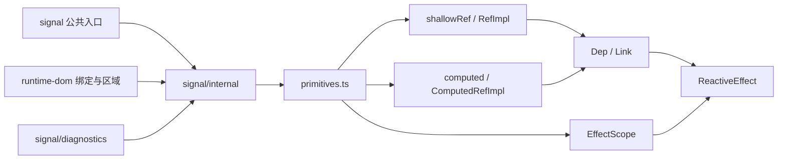

# ADR-001：保留单一自有响应式引擎

日期：2026-10-16。状态：接受；R-004 的 ESM/CJS、packed 物理副本与浏览器 bundle 边界验证已完成。

## 决策

保留当前 `RefImpl / Dep / ReactiveEffect / ComputedRefImpl / EffectScope` 引擎，删除没有运行时代码引用的 `alien-signals` 依赖。公共 API 继续只有 `createSignal`、`createMemo`、`createEffect`、`createRoot`、`onCleanup`、`batch`，第三方实现和代理工具不成为公共契约。禁止在同一个响应式依赖图中并用两套引擎。

这次审计没有证明迁移可以等价保留所有 owner、同步调度、cleanup 和异步 scope 语义，因此不切换引擎。局部修复已复现的清理错误，不重写追踪算法。

## 实际依赖链



`createSignal()` 返回对 `shallowRef.value` 的闭包。读取进入 `Dep.track()`，写入进入 `Dep.trigger()`，通知进入 `queueSubscriber/endBatch`，最终执行 `ReactiveEffect`。Memo 使用相同的 Dep/Link 图。`EffectScope` 捕获同一模块的当前 effect 与 scope；另外的 `scheduler.ts` 只服务内部显式队列，不改变公共 Effect 的同步执行方式。

静态源码与已构建产物的完整 import 列表、运行时对象名称见 [审计记录](./reactivity-audit-2026-10-16.json)。源码列表包含仅用于类型的 import/export，不能把它误读成执行时模块边。产物中：

- `signal.esm-bundler.js`、CJS 公共入口和 diagnostics 只依赖 `@zeus-js/signal/internal`。
- `internal.js/internal.cjs` 的唯一包级依赖是 `@zeus-js/shared`。
- 浏览器独立构建内联自有引擎。
- 源码与所有 JS/CJS 产物没有 `alien-signals` import/require。
- 运行时对象实际为 `RefImpl`、`Dep`、`ReactiveEffect`、`ComputedRefImpl`、`EffectScope`。

## Scope 与错误契约

公共 Effect 首次立即执行，之后同步更新，嵌套 batch 只在最外层退出时提交。Memo 惰性计算，缓存依赖版本；分支切换移除旧依赖，相同派生结果不会额外通知 diamond 的消费者。Signal 是浅容器，内部对象原地修改不通知；替换引用才通知。函数值通过 `setValue(() => functionValue)` 写入，直接传函数被解释为 updater。

Effect 的 cleanup 按注册顺序执行，发生在下一次执行前或停止时。Scope 按现有次序释放自身 effects、scope cleanup、子 scopes；停止幂等。每一级都尝试完成全部清理后重抛第一个错误，包括 `throw undefined` 等 falsy 值。停止前先将 effect/scope 标记失效，避免清理回调重入停止。一个 cleanup 失败不能让兄弟 effect 或子 scope 继续存活，不能留下 RUNNING 标记，也不能漏记 diagnostics。

`createRoot` 创建 detached owner，外层 owner 停止不隐式停止它。普通 `effectScope()` 随父 owner 停止。原有失效 scope 恢复、异步边界契约保留，没有增加全局模块唯一锁。

新增 `reactivity-contract.spec.ts` 覆盖浅容器/函数值、惰性 diamond、分支、嵌套 batch、嵌套 tracker、跨 owner、cleanup 异常和诊断。首批修复前 10 项中 5 项失败，后续补充的 batch falsy 异常用例也先复现失败，证明兄弟/子 scope 泄漏、运行状态未恢复、onStop 遗漏及 falsy 异常被吞；修复后 signal 套件 15 个文件、274 项通过。

当前重入策略仍沿用 `ReactiveEffect.notify()` 对正在运行的 effect 的自通知抑制；本 ADR 不把它宣称为完整的递归调度/最大迭代保护。设计要求的重入诊断及跨异步资源的扩展契约属于 R-006 后续工作。

## 包入口与重复实例

审计复现：ESM `createSignal()` 与 CJS `createEffect()` 混用时，写入 1 后消费者仍观察到 0。根因是 `internal.js` 和 `internal.cjs` 各自拥有 module-local `activeSub/activeEffectScope`。

修复：`./internal` 的 Node import 条件与 require 共享 CJS 引擎；浏览器 import 继续解析 ESM 引擎。正常重复公开入口不会创建第二个内部实例。开发/生产条件都验证 ESM↔CJS 的双向更新和 root disposal，diagnostics 同样共享实例。离线 packed consumer 用真实 `pnpm pack` 产物安装到临时工程，避免 TS path alias 掩盖入口问题。

限制：两个独立物理安装副本、直接加载不同浏览器独立 bundle 或任意多个版本仍可能构成两个引擎。本轮没有增加会禁止同 realm 独立应用的全局初始化锁，也没有宣称这些场景已自动去重。应用与库必须让同一树中的 `@zeus-js/signal` 解析到同一副本；跨副本边界现在会抛出明确的 `different Zeus signal engine` 错误，并在 packed consumer 与浏览器 bundle 测试中覆盖，但不会把两个独立应用强行合并成一个引擎。

## 可重复测量

在仓库根目录执行，先构建最新产物：

```sh
pnpm build signal shared runtime-dom zeus
NODE_ENV=production node packages/core/signal/scripts/reactivity-audit.mjs
pnpm check:runtime-interop
node packages/core/signal/scripts/check-packed-interop.mjs
pnpm exec vitest run --project unit packages/core/signal
```

可选对比已下载的 alien-signals 3.2.1，不为此重新引入项目依赖：

```sh
NODE_ENV=production node packages/core/signal/scripts/reactivity-audit.mjs \
  --alien-path /path/to/alien-signals/esm/index.mjs
```

记录环境为 Node 24.19.0、macOS arm64、production。每项预热 5,000 次，测量 50,000 次同步更新，5 轮取中位数；创建/清理不计入循环，断言消费者最终值及执行次数。此次记录基于包含本轮清理修复的新构建产物。热循环、JIT、GC 和同时运行的构建会影响结果；这不是应用级性能结论。

| 项目                                 | 自有引擎中位数 | alien-signals 3.2.1 中位数 |
| ------------------------------------ | -------------: | -------------------------: |
| 单 Signal → 单 Effect，50,000 次     |       2.932 ms |                   3.116 ms |
| Signal → 双 Memo → 单 Effect diamond |       8.602 ms |                   7.187 ms |

产物原始大小/gzip：公共 ESM facade 278/181 bytes，完整内部 ESM 57,512/14,504 bytes，内部生产 CJS 56,359/13,817 bytes，内联公共原语的浏览器生产 ESM 15,391/5,513 bytes。alien ESM 的 index 与 system 两个模块原始大小合计 15,790 bytes、逐模块 gzip 合计 3,124 bytes；它们没有 Zeus 的代理、watch、诊断与 owner 适配，且未采用相同 minifier，不能直接当作迁移后最终体积。

## 取舍与迁移门槛

| 维度       | 保留自有引擎                                     | 迁移 alien-signals                                 |
| ---------- | ------------------------------------------------ | -------------------------------------------------- |
| 功能契约   | 已有 Proxy/Map/Set、watch、scope、诊断及回归套件 | 必须证明所有既有契约等价                           |
| 大小与性能 | 公共内联构建仍有缩减空间；当前微基准无阻塞性问题 | 原始引擎较小、此次微基准较快；适配成本未计入       |
| Scope 兼容 | 现有 owner 与异步恢复路径直接使用                | 需适配 cleanup 顺序、异常、detached root、失效恢复 |
| 许可证     | 仓库 MIT                                         | 本地 3.2.1 package 标注 MIT，无许可冲突证据        |
| 升级风险   | 团队承担算法与生命周期维护                       | 外部依赖升级与适配层维护，不能暴露其内部对象       |

未来只有在完整契约与 packed consumer 矩阵通过、相同构建条件下有明确收益、Scope 适配可独立审查后才重新审议。切换必须一次性替换唯一引擎，不能让一个绑定同时追踪两个依赖图。
