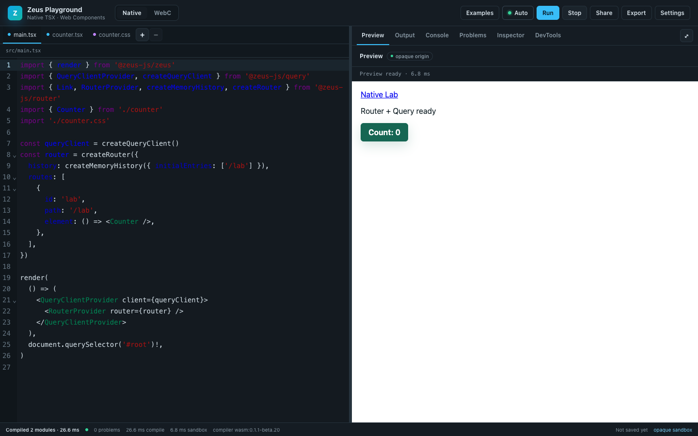
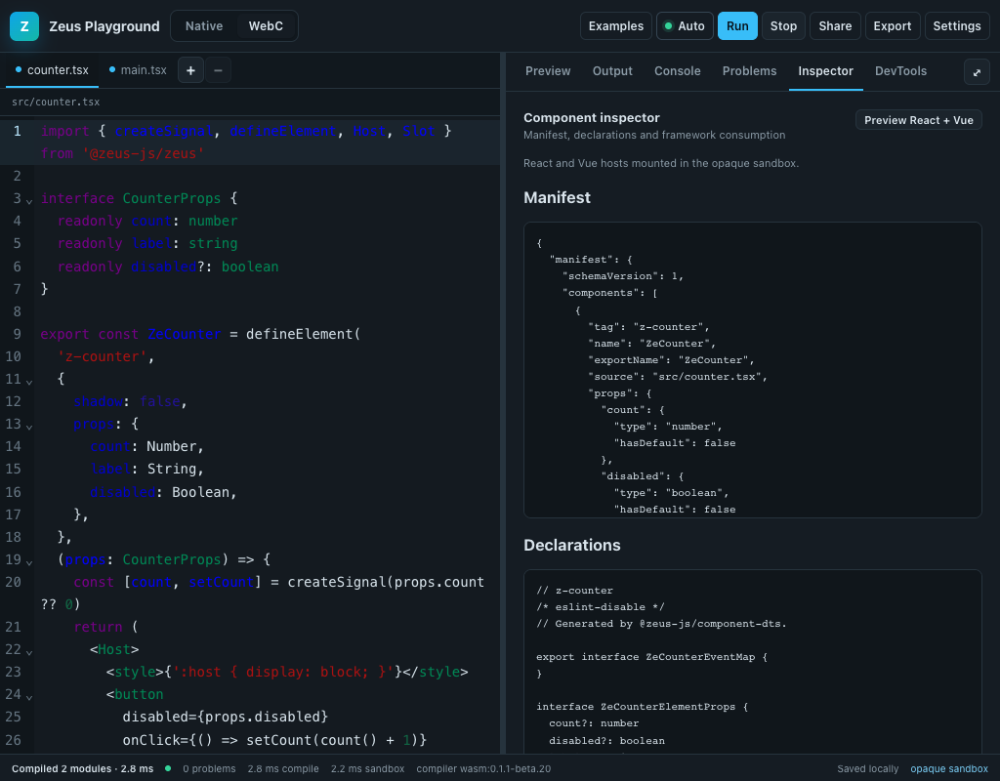
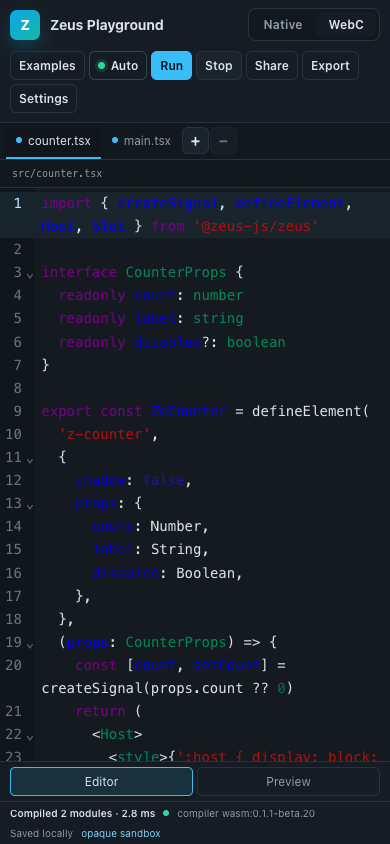
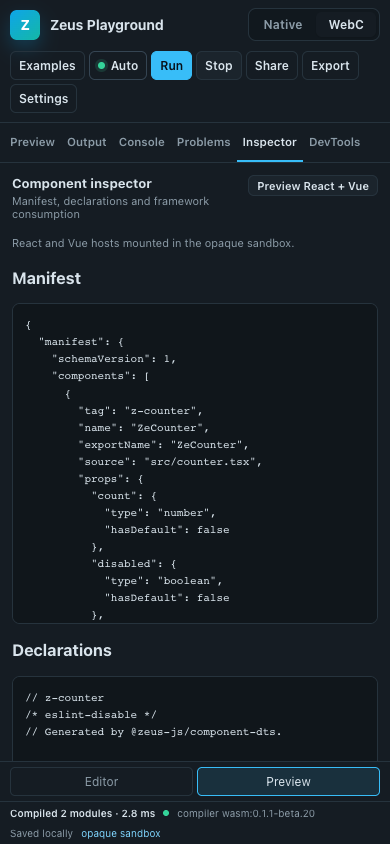

# Playground UX Redesign

Date: 2026-11-07

## Scope

`examples/playground-editor` was an engineering test console for Native Lab and
WebC Studio. This change turns the same product pair into a developer-facing
Playground without changing its execution model:

- Zeus Native TSX + signals stay the implementation. No React rewrite.
- The Rust/WASM Worker compiler, `@zeus-js/playground-engine` build contract,
  DOM/SSR output, manifest/DTS inspector, multi-file projects and project
  export are preserved.
- The opaque-origin sandbox, HTTP CSP, parent-origin allowlist and session
  validation are unchanged. The P0 negative tests are rerun in the same gate.
- The new UI is split into a controller, a shell of Zeus components, a lazy
  CodeMirror module, persistence/share helpers and an examples catalogue.

## Information architecture

```text
┌ TopBar: brand · Native/WebC · Examples · Auto · Run · Stop · Share · Export · Settings
├ FileBar: files + add/remove + editable path
├ Editor pane (CodeMirror 6)          │ Results pane
│                                     │ Preview / Output / Console / Problems / Inspector / DevTools
│                                     │ Splitter · preview maximize
├ StatusBar: build status · problems · compile/sandbox ms · save state · opaque sandbox
└ ExampleDrawer / Toast / Settings popover
```

The result tabs are present in both products. Inspector explains that manifest
inspection is WebC-only when the project is Native; DevTools explains that the
runtime counters are Native-only when the project is WebC. This keeps the
navigation predictable across product switches instead of changing the tab set.

### Responsive matrix

| Viewport   | Layout                                                                        |
| ---------- | ----------------------------------------------------------------------------- |
| 1440 × 900 | Two panes at the persisted ratio; draggable 6 px splitter.                    |
| 1024 × 800 | Two panes, compact toolbar, all six result tabs visible.                      |
| 390 × 844  | One pane; Editor/Preview switch; result tabs compress to fit; Settings wraps. |

Persisted settings: theme, font size, auto-run, split percentage and active
result tab. They live in `localStorage` under `zeus-playground.settings.v1`.
Projects live in IndexedDB (`zeus-playground`, schema version 1) with a 1.5 MB
budget, 32-file limit, safe-path validation and a memory fallback. Corrupt or
version-mismatched records are ignored rather than crashing the shell.

## Interaction model

### Auto-run state machine

- Edits schedule one compile after 700 ms. Repeated edits clear the pending
  timer, so 30 edits produce one compile.
- A manual Run clears the pending timer and starts immediately.
- Every build receives a monotonically increasing revision. A result whose
  revision is no longer current is discarded, so an older compile cannot replace
  a newer preview.
- On a compiler error the last successful preview stays mounted and is marked
  stale; Problems opens with the diagnostic.
- Run/Stop are explicit. Stop invalidates in-flight revisions and asks the
  sandbox to stop executing.
- The first successful build reveals Preview; later successful builds do not
  steal the user's selected Output/Console/Inspector tab unless they were on
  Problems.

### Editor

CodeMirror 6 is lazy-loaded. TypeScript/TSX/JavaScript/CSS highlighting, line
numbers, history, bracket matching and indentation are enabled. `Mod-Enter`
runs, `Mod-S` saves, and compiler diagnostics for the active file are rendered
as line decorations. The fallback textarea keeps the first editable surface
available while the chunk loads.

### Console and Problems

The sandbox intercepts `console.log/info/warn/error` after the opaque-origin
gate and posts bounded entries over the already-validated message channel:

- at most 50 queued entries and 50 per flush;
- 100 entries per second;
- each entry truncated to 2,048 characters;
- DOM nodes, windows and unbounded values never cross the boundary.

The host parser validates every field again. Problems carry path, line, column,
severity and compiler code; clicking a diagnostic focuses that line.

## Share and export

Small projects share as `#p=g.<base64url(gzip(json))>`; if compression is
unavailable the fallback is `u.<base64url(json)>`. URLs are capped at 18,000
characters and projects at 900 KB. Gzip decompression is streamed with a hard
output cap, so a compressed bomb is rejected before it can expand past the
budget. Larger projects download a JSON project file. Settings and tokens are
never included. Export still produces the external project ZIP with the
expected package root, `custom-elements.json` and `zeus.components.json`.

## Examples

Twelve runnable projects are shipped:

- Native: hello, counter, Show/For, props, todo, lifecycle, Router + Query.
- WebC: basic element, counter with slots, props/events, shadow DOM, light-DOM
  slots.

Every example is loaded and compiled by the Chromium UX gate; the Native/WebC
gates then verify their product-specific output.

## Performance

Measured locally on macOS arm64, Chromium (Playwright `channel: chromium`),
headless, 1440 × 900, against the production build served without compression.
Full data: [performance.json](./playground-ux-redesign-2026-11-07/performance.json).

| Metric                                  | Value                                       |
| --------------------------------------- | ------------------------------------------- |
| Shell JavaScript (raw / gzip)           | 605,269 B / ~159.6 KiB                      |
| Main entry chunk (raw / gzip)           | 66,983 B / 18,574 B                         |
| CodeMirror lazy chunk raw/gzip          | 529,595 B / 177,440 B                       |
| Compiler assets (Babel + WASM + Worker) | 3,754,555 B raw / ~1.0 MiB gzip             |
| CSS raw / gzip                          | 17,237 B / 4,049 B                          |
| All resources raw                       | 4,906,956 B                                 |
| First editable source                   | 181 ms                                      |
| First preview ready                     | 445 ms                                      |
| WASM compile / sandbox run              | 7.1 ms / 2.8 ms (warm, small project)       |
| 30 edits                                | 1 compile in 1,985 ms, final source visible |
| 10 consecutive builds                   | 1 iframe, +634,908 B heap after GC          |

The compiler assets dominate first preview; the shell and editor chunks are
independent of them. The compiler Worker is reused. Repeated builds replace the
sandbox iframe instead of accumulating realms. Stop leaves one stopped iframe
as the preview surface (it no longer executes); navigating away disposes the
preview controller.

## UX gate

`pnpm check:playground-ux` runs Chromium, Firefox and WebKit through:

1. initial auto preview at 1440;
2. console bridge;
3. diagnostics, stale preview, problem-to-editor focus and recovery;
4. add/switch/remove files;
5. auto-run off, manual Run, auto-run on;
6. keyboard Run/Save;
7. preview maximize and split drag, including pointer capture over the iframe;
8. Settings theme and font size;
9. example gallery plus all twelve examples (Chromium);
10. Stop and rerun;
11. persistence across reload (source, split width and active tab);
12. share URL round-trip in a second tab;
13. WebC manifest, DTS, inspector and React 19/Vue 3 consumption;
14. 1024 and 390 layouts, mobile Editor/Preview toggle, no horizontal overflow,
    and accessible button names.

The 1440/1024/390 captures are checked in with the report:






Results:

- UX gate: Chromium PASS, Firefox PASS, WebKit PASS
  ([ux-report.json](./playground-ux-redesign-2026-11-07/ux-report.json)).
- Official Playground gate: all three engines PASS, including external export
  and WebC export ([playground-gate-report.json](./playground-ux-redesign-2026-11-07/playground-gate-report.json)).
- P0 security probe per engine: `parentDom=false`, `parentStorage=false`,
  `localCookies=false`, `localFetch=false`, `directOpaqueGate=true`,
  `thirdPartyEmbedBlocked=true`.

## Known limits

- Compiler assets are still downloaded on the first build; they are not
  prefetched or split further in this change.
- Performance numbers are local and machine-specific, not a CI threshold.
- The preview document is intentionally user-owned; a dark-shell project that
  does not style its own `body` still renders on the browser's white canvas.
- Mobile uses a single-pane switch rather than a collapsed split; this matches
  the 390 px requirement and avoids a 6 px drag target on touch.
